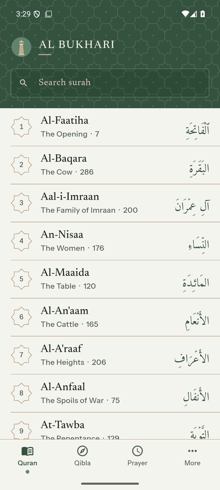
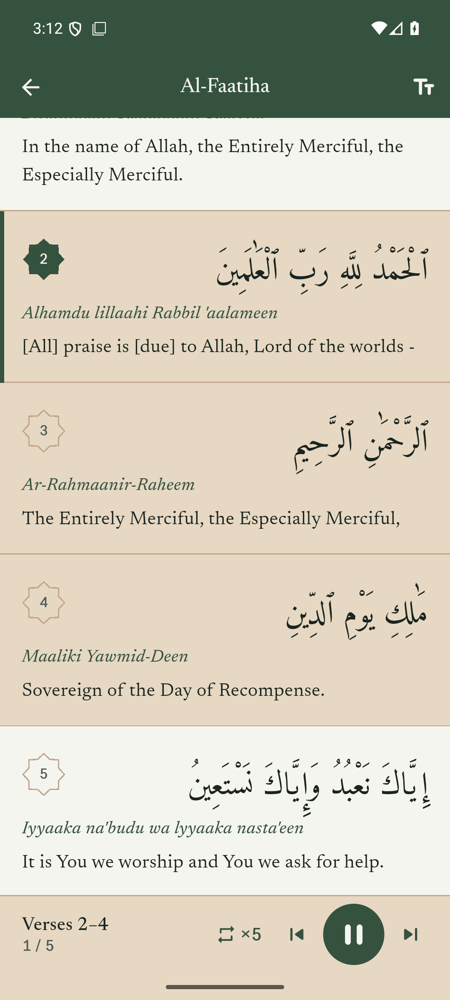
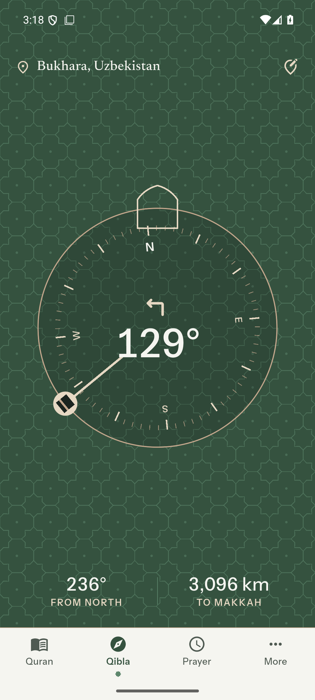
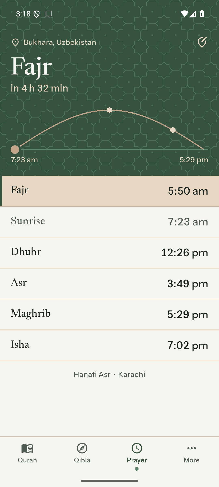
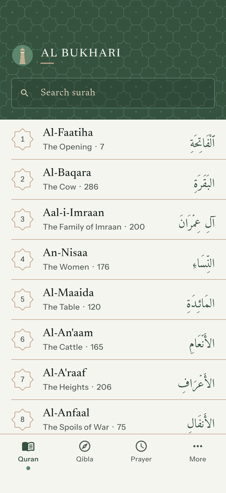
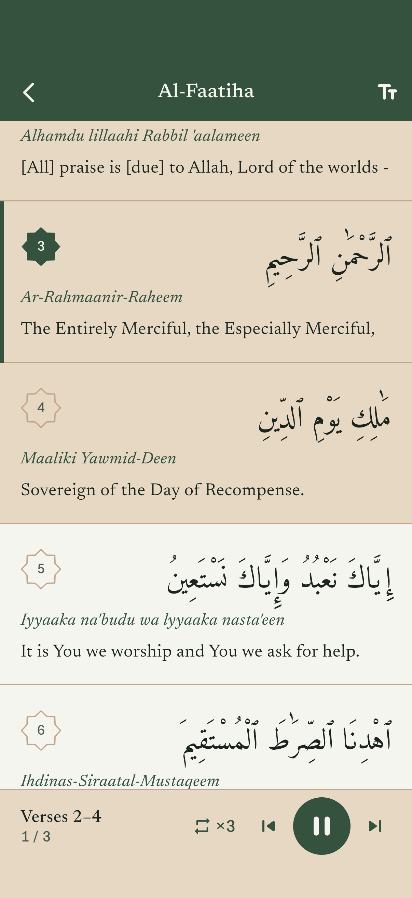
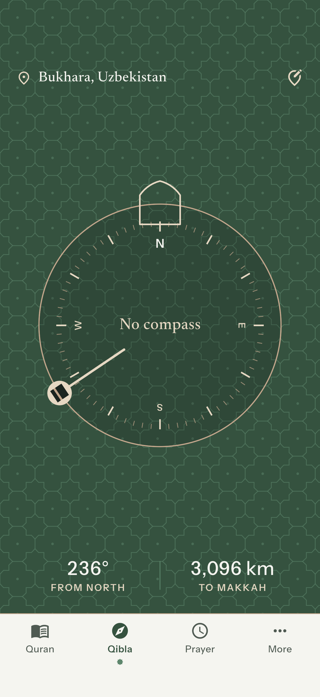
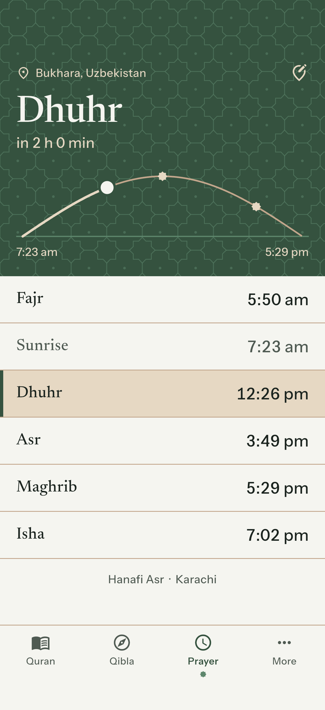

# Al Bukhari

The Quran in Arabic, English and English phonetics, with verse, range and
surah repeat for memorisation, a Qibla compass and Hanafi prayer times.
No accounts, no ads, no tracking: everything is worked out on the phone.

| | Quran | Repeat | Qibla | Prayer |
|---|---|---|---|---|
| Android |  |  |  |  |
| iPhone |  |  |  |  |

## What it does

- **Quran**: all 114 surahs offline. Each verse in Arabic, phonetic English
  and Saheeh International translation. Search surahs by name or number.
- **Memorise**: tap a verse to play it. The repeat button picks Verse, Range
  (from/to) or whole Surah, and ×1, ×3, ×5, ×10 or ∞. Long-press a second
  verse to repeat everything between. Previous/next skip verses. Each verse is
  downloaded once, then plays without internet.
- **Qibla**: line the Kaaba up under the arch at the top; the phone vibrates
  when you face it. True north is corrected on the phone.
- **Prayer times**: next prayer, countdown, the day's sun path. Hanafi Asr
  and the Karachi method by default; others in More.
- **Place**: GPS (approximate only), or type a city (34,000 cities, searched
  offline) or coordinates like `41.31, 69.24`. A chosen city's prayer times
  use that city's own time zone.
- **More**: reciter (Al-Husary or Alafasy), show/hide phonetic and English,
  method, Asr, privacy policy, sources.

The only thing the app ever downloads is verse audio, from
`cdn.islamic.network`, when you press play.

## Run it (Windows, Android)

You need Flutter, Rust and Android Studio installed (already done on this
computer).

1. Plug in an Android phone with **USB debugging** on, or start the emulator:
   Android Studio → Device Manager → ▶ on a device.
2. Open PowerShell in this folder and run:

```powershell
.\deploy.ps1 -Install
```

That builds the app, installs it and opens it. The first build takes about
6 minutes; later builds about 2.

Other options:

```powershell
.\deploy.ps1
```

Builds only. The file is `build\app\outputs\flutter-apk\app-release.apk`;
copy it to any Android phone and open it.

```powershell
.\deploy.ps1 -Store
```

Builds the `.aab` bundle that Google Play asks for.

## Before publishing on Google Play

- Create a release signing key and use it in `android/app/build.gradle.kts`
  (the build is currently signed with the debug key).
- Host `assets/legal/privacy.md` at a public web address.
- Data safety form: no data collected, no data shared.
- New personal developer accounts need a closed test with 12 testers for 14
  days before release.
- Translation and recitations are licensed for non-commercial use: the app
  must stay free with no ads.

Full store, privacy and design rules: [docs/RULEBOOK.md](docs/RULEBOOK.md).
Structure and what is next: [docs/PRIORITIES.md](docs/PRIORITIES.md).

## Change the bundled data

```bash
node tool/build_data.mjs
```

Rebuilds the Quran text and city list from their public sources.

## iOS (no Mac needed)

The same code builds for iPhone on a GitHub-hosted Mac. It has been run
end to end on the iPhone simulator (screenshots above).

**Get a build:** every push that changes the app builds it automatically.
To build by hand: GitHub → **Actions** → **iOS** → **Run workflow**. When it
finishes (about 15 minutes), download **AlBukhari-ios-simulator** from the
run page.

**Try it in your browser:** upload that zip at appetize.io (free account).
It runs the real app on a virtual iPhone. The simulator has no compass, so
the Qibla screen shows the direction without turning.

**On your iPhone:** Apple only lets you install apps through TestFlight or
the App Store, which needs an Apple Developer account ($99 a year). With
one, the build can be signed and sent to TestFlight by the same workflow.

Apple's App Store also requires the build to come from Xcode 26 or later,
which the GitHub Mac provides.
